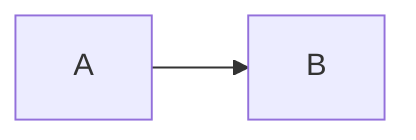

# Markdown 扩展使用示例

本文提供文章中可使用的 Markdown 扩展最小示例。语法状态、参数、默认值及运行时成本以 [Markdown 语法清单](../src/plugins/markdown/manifest.json) 为准；开发约定见 [Markdown 扩展开发规范](markdown-extensions.md)。

图片路径需替换为文章实际资源；GitHub 卡片需替换为目标仓库。代码树目录简写读取仓库内真实目录，使用前应确认目录内容适合公开。

## Abbreviation

使用标准缩写定义行，为当前文章中匹配的术语输出带完整释义的原生 abbr 元素。

````markdown
*[SSR]: Server-Side Rendering

SSR 输出可直接阅读。
````

## Admonition

使用容器指令或 GitHub alert blockquote 表达提示信息，并使用原生 details 提供可折叠补充内容。

````markdown
:::tip[提示]
正文
:::
````

````markdown
::: warning 部署前检查
正文
:::
````

````markdown
> [!NOTE]
> 正文
````

## Code Tree

将多文件代码示例或本地目录渲染为可折叠目录导航与可切换代码面板。

````markdown
:::code-tree{title="组件示例" height="420px" entry="Button.svelte"}
```svelte title="Button.svelte"
<button>Click</button>
```
:::
````

````markdown
@[code-tree title="站点配置" entry="siteConfig.ts"](/src/config)
````

## Collapse Panels

将一个顶层无序列表渲染为原生折叠面板组，并支持独立多开或手风琴单开模式。

````markdown
::: collapse accordion
- :+ 标题

  面板正文
:::
````

````markdown
:::collapse{expand=true}
- 标题

  面板正文
:::
````

## Content Annotation

通过行内标签引用文章内集中定义的补充说明，并使用原生 Popover 在需要时显示内容。

````markdown
Astro 使用孤岛架构 [+islands]。
````

````markdown
[+islands]:
  孤岛是由静态 HTML 包围的交互组件。
````

引用和同名定义需放在同一篇文章中。

## Expressive Code fence metadata

为 fenced code block 提供标题、frame、行/文本标记、换行、折叠和行号元数据。

````markdown
```js title="app.js" ins={2} collapse={4-8} showLineNumbers
const app = true
```
````

## File Tree

将嵌套 Markdown 列表或终端 tree 输出转换为可折叠文件树。

````markdown
:::file-tree{title="src"}
- src/
  - index.ts
:::
````

````markdown
```file-tree title="dist" icon="simple"
dist
└── index.html
```
````

## GitHub Repository Card

根据 owner/repo 渲染仓库卡片，并在客户端读取 GitHub API。

````markdown
::github{repo="LyraVoid/Shirone"}
````

当前状态为 `legacy`；采用前请阅读清单中的兼容说明。

## Image Grid

将容器内 Markdown 图片渲染为响应式画廊，并按容器隔离灯箱分组。

````markdown
:::grid{columns="3" aspect="16/9" fit="cover"}


:::
````

## Image Width and Caption

在图片 alt 中使用 w-N% 控制独立图片宽度，并将 Markdown title 渲染为可见图注。

````markdown

````

## Marker Highlight

使用双等号高亮正文短语，并以可选语义变体表达不同强调层级。

````markdown
使用 ==主题主色强调== 标记核心结论。
````

````markdown
==需要修正的条件=={.error}
````

## Math and KaTeX

使用美元符号定界的 LaTeX 数学表达式，并在构建期渲染为 KaTeX。

````markdown
Euler: $e^{i\pi}+1=0$
````

````markdown
$$
E = mc^2
$$
````

## Mermaid Diagram

将 mermaid fenced code 保留为可读 fallback，并在客户端按需增强为主题化 SVG。

````markdown

````

## Option Groups

将多个完整 Markdown 片段渲染为可同步、可记忆且支持键盘操作的 M3E 选项组。

````markdown
::: tabs#runtime

@tab Node.js#node

Node 正文。

@tab:active Bun#bun

Bun 正文。

:::
````

## Inline Spoiler

将 text directive 输出为 spoiler 自定义元素并使用 CSS 隐藏内容。

````markdown
答案是 :spoiler[42]。
````

当前状态为 `legacy`；采用前请阅读清单中的兼容说明。

## Steps

将单个有序列表增强为无外框的序号导轨步骤流，非法或混合输入保留为普通 Markdown。

````markdown
:::steps{title="部署流程"}
1. **准备环境**

   克隆仓库并安装依赖。
2. **启动服务**

   运行构建并发布。
:::
````

````markdown
:::steps[快速入门]
1. 安装依赖
2. 启动开发服务器
:::
````
