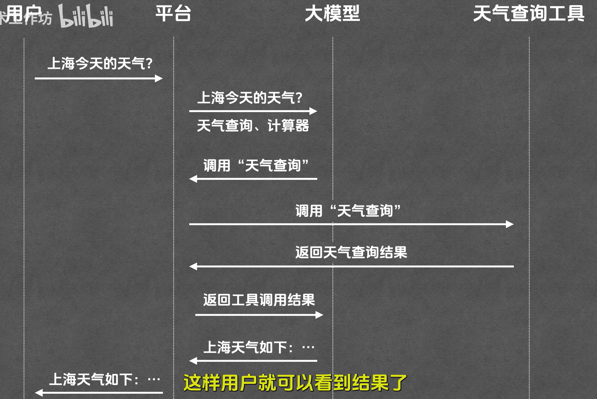

# AI 核心概念

# LLM

- 全称：Large Language Model（大模型）
- 基本上现在所有的大模型都是基于 transformer 训练出来的（《_Attention Is All You Need》_）

# Token

- Tokenizer：负责编码（文字-> 数字）和解码（数字-> 文字）

  - 编码：切分 + 映射
    - 切分：把文字分成一个个片段（token 就是文字）
    - 映射：把每个片段映射成数字（也就是 token id）
  - 随后输入模型
  - 解码：映射（把数字转化成文字）
- 是大模型处理文本的最基本单元
- 平均来讲，1 个 token 大概是 0.75 个英文单词，1.5~2 个汉字

# Context

- 大模型每次处理任务时接收到的信息总和（上下文）
- Context window（上下文窗口）：context 能够容纳的最大 token 数量

  - 目前主流模型的 context window 大概 100 万

## RAG

- 可以从内容中抽取最为匹配的几个片段，只把这几个片段发给大模型，极大降低成本

# Prompt

- Prompt（提示词）：大模型接收的具体问题或指令
- Prompt Engineering（提示词工程）：研究怎么把话说得让大模型更清楚
- Prompt 分类

  - User Prompt（用户提示词）：说明具体任务，是用户自己输入的
  - System Prompt（系统提示词）：说明人设和做事规则，是开发者在后台配置的

# Tool

- Tool 本质上是一个函数
- 完整流程

  - 角色列表：用户、大模型、工具（比如天气查询工具）、平台（传话筒)
  - 各角色的职责
    - 大模型：选择工具 & 归纳总结
    - 工具：查询天气
    - 平台：串联流程
      

# MCP

- Model Context Protool（模型上下文协议）：统一的工具接入规范

# Agent

- 能够自主规划、自主调用工具直至完成用户任务的系统
- Agent 产品使用的主要构建模式有

  - ReAct
  - Plan And Excute

# Agent Skill

- 提前写好给 Agent 看的说明文档，本质上是一个 Markdown
- 整体结构可以分为元数据层（Name+Description）、指令层
