# HTML 语法结构

## 文档基本结构

- **文档声明：**`<!DOCTYPE html>`

  - 用于告诉浏览器该文档是 HTML5 文档，它帮助浏览器正确地解析和显示网页内容。
- **根标签：**`<html>`

  - 是 HTML 文档的根元素，包含整个网页的内容，其 lang 属性可以指定文档的语言。
- **头部标签：**`<head>`

  - 包含文档的元信息，如文档标题、字符集、样式表链接、脚本引用等。
- **主体标签：**`<body>`

  - 包含网页的可见内容，如文本、图像、链接、表格、表单等，是用户实际看到和交互的部分。

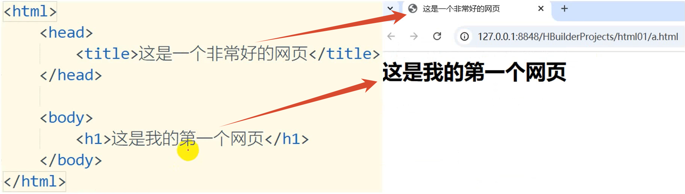

## 标签的分类

- **双标签**

  - 如 `
`（段落）、`<h1>`（标题）、`
`（块级容器）等
  - 有开始标签和结束标签，内容写在开始标签和结束标签之间，用于包裹一段内容并对其进行格式化或布局。
- **单标签**

  - 如 ` `（换行）、`
`（水平线）、``（图像）等
  - 只有开始标签，没有结束标签，通常用于表示一个简单的操作或插入一个元素。

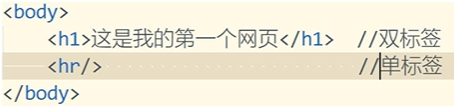

## 注释的使用

- 注释的语法：**<!--注释内容-->**
  - 可以写在标签之间，也可以写在标签内部，
  - 可以是单行的，也可以是多行的。
  - `Ctrl + /` 快速创建注释

## 标签的属性

- 格式：**< 标签名属性名 1=“属性值 1” 属性名 2=“属性值 2”…>**
  - 属性需要定义在开始标签中或单标签中
  - 属性实际上是一组一组名值对，结构如下：

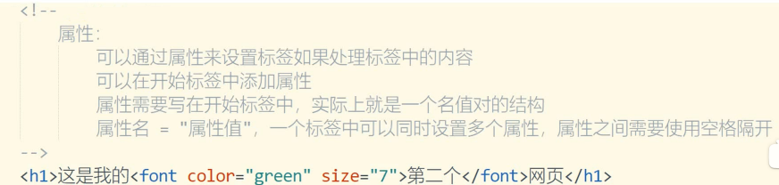

## HTMIL 字符编码与语言属性

- **字符编码**

  - **概念**：用于将字符转换为计算机可以识别的二进制数据的规则和标准，不同的字符编码可以表示不同字符集，如 ASCII、GB2312、GBK、UTF-8。
  - **使用**：通过在 `<meta>` 标签中使用 charset 属性指定字符编码，如 `<metacharset="UTF-8">`，通常将字符编码设置为 UTF-8，以支持多种语言和特殊字符的显示。
- **语言属性**

  - **使用**：在 `<html>` 标签中使用 lang 属性可以指定文档的语言，如 lang="zh-CN"表示文档的语言为中文（中国），语言属性有助于搜索引擎优化和无障碍访问。

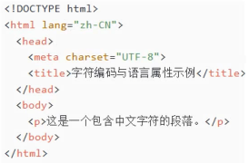

---

# 常用 HTML 标签*

## 文本内容标签

- **标题标签：**`<h1>` 到 `<h6>`

  - 用于定义不同级别的标题，<h1>表示最重要的标题，<h6>表示最不重要的标题
- **段落标签：**`
`

  - 用于定义段落文本
- **水平线标签：**`
`

  - 用于在页面中添加一条水平线，是一个单标签
- **加粗标签：**`<strong>` 或 `<b>`

  - `<strong>` 表示重要的加粗文本，`<b>` 表示普通的加粗文本，推荐使 `<strong>` 以传达语义
- **换行标签：**` `

  - 用于在文本中强制换行，是一个单标签
- **斜体标签：**`<em>` 或 `<i>`

  - Emphasis tag / Italic tag
  - `<em>` 表示强调的斜体文本，`<i>` 表示普通的斜体文本，推荐使用 `<em>` 以传达语义。

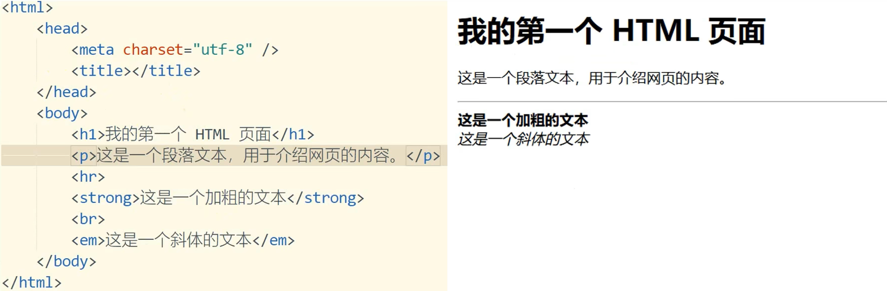

## 图像与多媒体标签

- **图像标签：**``，用于在网页中插入图像
  - src：指定图片的路径
  - alt：用于为图像添加替代文本（图片没加载出来时）
  - width：设置图片的宽度
  - height：设置图片的高度

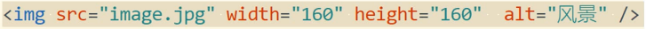

## 超链接标签

- **超链接标签：**`<a>`，用于创建超链接
  - href：指定链接的目标地址，
  - target：可设置链接的打开方式，如 _blank 表示在新窗口打开，_self 表示在当前窗口打开

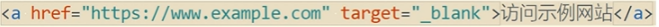

## 表格标签

- **表格标签：**`<table>`，用于创建表格

  - border：可设置表格的边框
  - cellpadding：可设置单元格内容与边框之间的间距
  - cellspacing：可设置单元格之间的间距
- **表格标签：**`<tr>`，用于定义表格中的一行，每一行包含多个单元格。
- **表格单元格标签：**`<td>`，用于定义表格中的一个单元格，
- **表头单元格标签：**`<th>`，用于定义表格中的表头单元格，

  - 通常用于显示表格的列标题或行标题，表头单元格默认具有加粗和居中的样式。

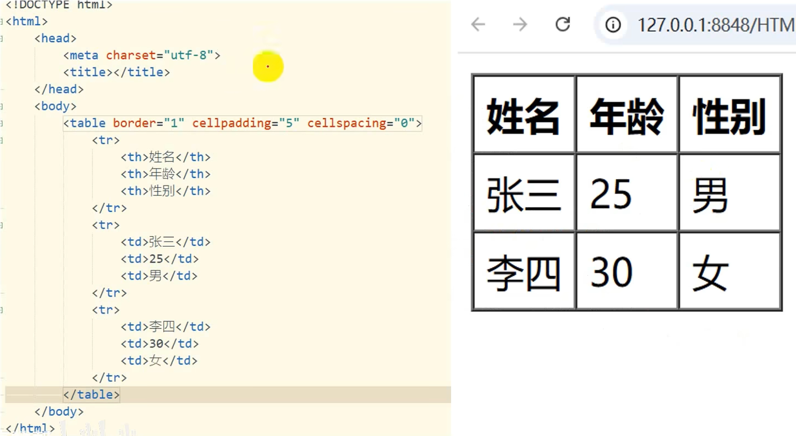

## 列表标签

- **无序列表标签：**`<ul>`（Unordered List）
  - 用于创建无序列表，列表项使用 `<li>` 标签定义，
  - 可通过 type 属性 设置列表项的标记类型，如 disc（圆点）、circle（空心圆）、square

（方块）等

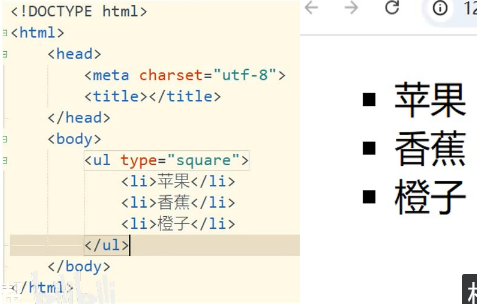

- **有序列表标签：**`<ol>`（Ordered List）
  - 用于创建有序列表，列表项使用 `<li>`（list item）标签定义，
  - 可通过 type 属性设置列表项的编号类型，如 1（数字）、a（小写字母）、A（大写字母）、i（小写罗马数字）、｜（大写罗马数字）

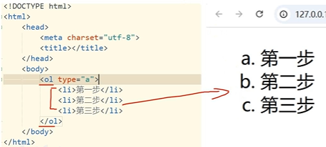

- **自定义列表标签：**`<dl>`（Definition List）
  - 用于创建自定义列表，通常用于对术语或名词进行解释和描述
  - 列表项使用 `<dt>`（Description Term ）标签定义
  - 列表项的描述使用 `<dd>`（Description Details）标签定义

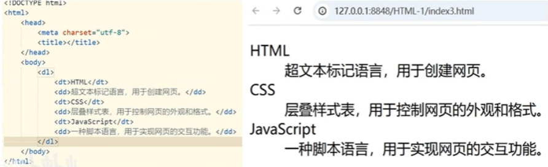

---

# 表单*

## 表单基本结构

- **表单标签：**`<form>`：用于创建表单

  - 其基本结构为 `<form>` 和 `</form>`
  - 表单内的各种表单元素都应放置在 `<form>` 标签对中
- **常用属性**

  - action：指定表单提交的目标地址，当用户提交表单时，表单数据会被发送到该地址
  - method：指定表单提交的方式，常用的有 get 和 post
    - get 方式会将表单数据附加在 URL 后面，post 方式会将表单数据放在请求体中

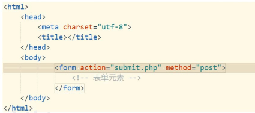

## 单行文本输入框

- **标签格式：**`<input type="text">`

  - 用于创建单行文本输入框，用户可以在其中输入文本
- **常用属性**

  - name：指定输入框的名称，用于在提交表单时标识该输入框的数据。
  - value：指定输入框的初始值，即显示在输入框中的默认文本。
  - placeholder：指定输入框的占位符文本，用于提示用户输入的内容。

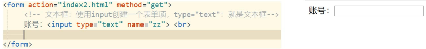

## 密码输入框

- **标签格式：**`<input type="password">`

  - 用于创建密码输入框
  - 用户输入的密码会以星号（*）或圆点（・）的形式显示。
- **常用属性**

  - 与单行文本输入框类似，常用的有 name、value 等，用于控制密码输入框的名称、初始值等。

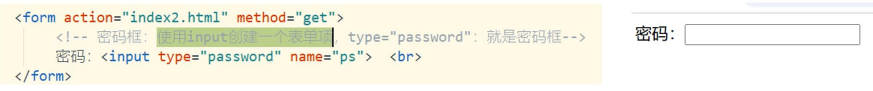

## 表单选按钮

- **标签格式：**`<input type="radio">`

  - 用于创建单选按钮，用户可以在多个选项中选择一个。
- **常用属性**

  - name：指定单选按钮名称，同一组单选按钮的名称应相同，以便在提交表单时只提交选中的选项的值。
  - value：指定单选按钮的值，当该单选按钮被选中时，其值会被提交到服务器。
  - checked：设置单选按钮为选中状态，页面加载时该单选按钮会被默认选中。

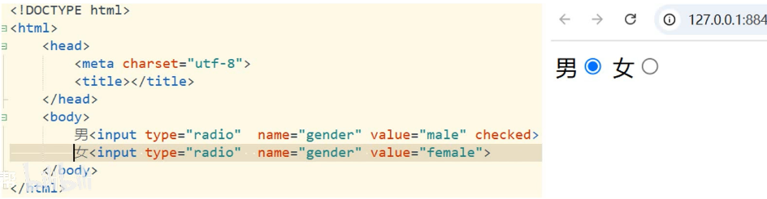

## 复选框

- **标签格式：**`<input type="checkbox">`

  - 用于创建复选框，用户可以选择多个选项
- **常用属性**

  - name：指定复选框的名称，同一组复选框的名称应相同，以便在提交表单时提交所有选中的选项的值。
  - value：指定复选框的值，当该复选框被选中时，其值会被提交到服务器。
  - checked：设置复选框为选中状态，页面加载时该复选框会被默认选中。

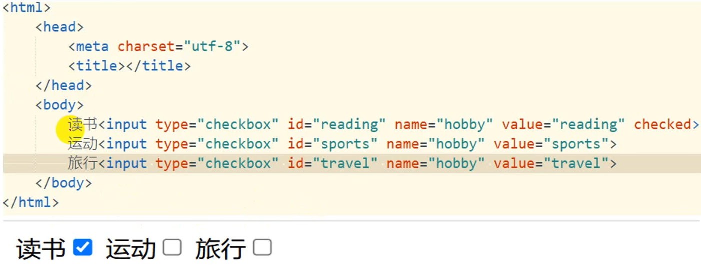

## 按钮

- **标签格式：**`<input type="submit">`，用于创建**提交**按钮

  - 用户点击该按钮后，表单数据会被提交到服务器。
  - 常用属性：value
    - 指定提交按钮的值，即显示在按钮上的文本。
    - 用户点击该按钮后，表单中的所有表单元素都会恢复到初始值。
- **标签格式：**`<input type="reset">`，用于创建**重置**按钮，

  - 常用属性：value
    - 指定重置按钮的值，即显示在按钮上的文本。

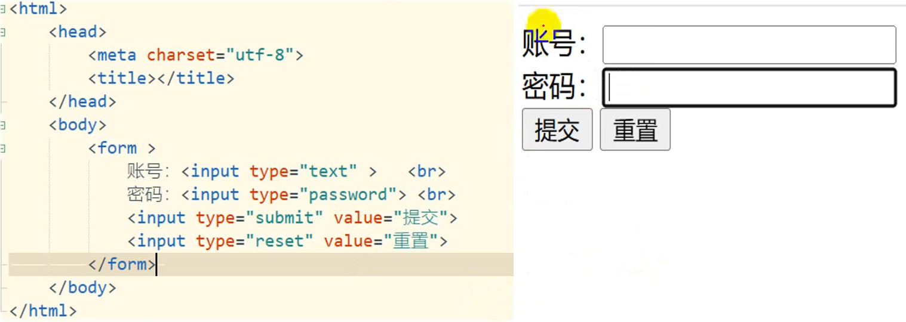

## 表单验证与提示

- **表单验证属性**

  - required：设置表单元素为必填项，用户在提交表单前必须填写该元素。
  - pattern：指定表单元素的输入格式，使用正则表达式来验证用户输入的内容是否符合要求。
- **表单提示文本**

  - placeholder：为表单元素添加占位符文本，提示用户输入的内容。
  - title：为表单元素添加提示文本，当用户将鼠标悬停在表单元素上时，会显示该提示文本

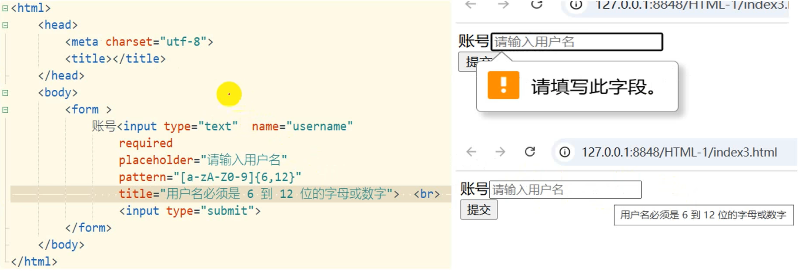

---

# CSS 基础知识*

## CSS 的引入方式

- **内联样式**

  - 直接在 HTML 元素的 style 属性中定义样式，如 `
这是一段红色文字。
`
- **内部样式表**

  - 在 HTML 文档的 `<head>` 部分使用 `<style>` 标签定义样式，如下图所示：
    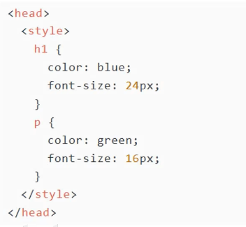
- **外部样式表**

  - 将样式代码存储在一个单独的 .css 文件中，并通过 `<link>` 标签将其引入 HTML 文档，如下图所示：
    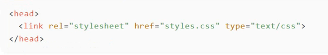

## CSS 的基础语法

- **选择器**：用于指定要应用样式的 HTML 元素，如 h1、#id、.class 等。
- **属性**：用于定义要应用的样式，如 color、font-size、background-color 等。
- **值**：属性对应的值，如 red、16px、#ffff 等。

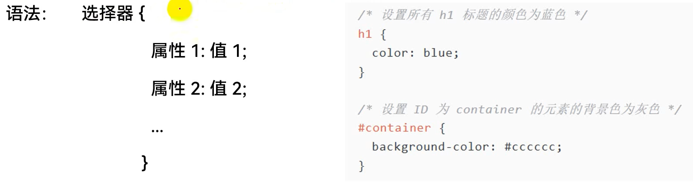

## 选择器类型

- **元素选择器**：选择 HTML 文档中的某个特定元素，如 p、div 等。
- **ID 选择器**：选择具有特定 id 属性的元素，以#开头，如#header、#content 等。
- **类选择器**：选择具有特定 class 属性的元素，以.开头，如.highlight、info 等。

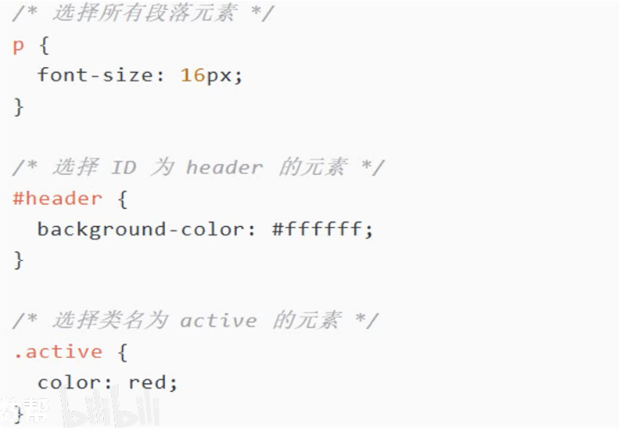

- **属性选择器**：根据元素的属性或属性值来选择元素，如[type="text"]、[href="#"]等。
- **伪类选择器**：用于选择元素的特定状态，如 a:hover（鼠标悬停在链接上时）等。

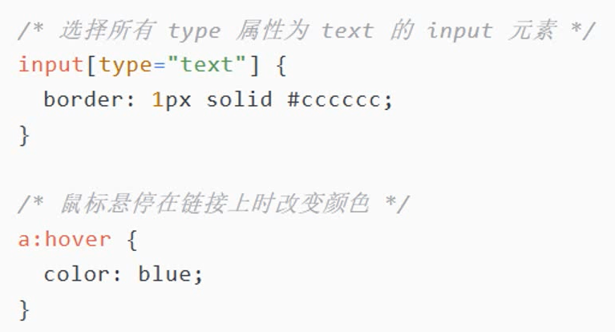

---

# CSS 属性*

## 字体属性

- **字体系列**

  - 通过 `font-family` 属性设置字体系列，可指定多个字体，以逗号分隔
  - 当第一个字体不可用时，会尝试下一个字体。
- **字体大小**

  - 通过 `font-size` 属性设置字体大小，
  - 可使用相对单位（如 em）或绝对单位(如 px、pt)，1em=16px
- **字体粗细**

  - 通过 `font-weight` 属性设置字体粗细
  - 可取值为 normal（正常）、bold（加粗）、bolder（更粗）、lighter(更细）或具体的数值(100-900)
- **字体样式**

  - 通过 `font-style` 属性设置字体样式
  - 可取值为 normal（正常）、italic（斜体）、oblique（倾斜）等。
- **font 属性**

  - 可以使用 `font` 属性综合设置字体系列、大小、粗细和样式等
  - 格式为 font: font-style font-weight font-size font-family;。

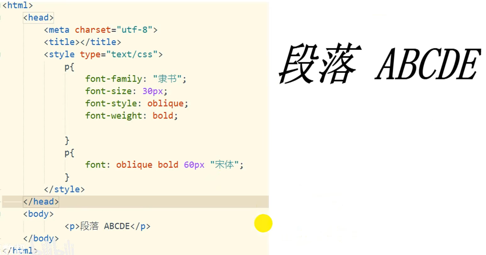

## 文本属性

- **文本对齐**：通过 `text-align` 属性设置文本的对齐方式

  - 可取值为 left（左对齐）、right（右对齐）、center（居中对齐）等。
- **文本缩进**：通过 `text-indent` 属性设置文本的首行缩进，常用于段落的排版。
- **行高**：通过 `line-height` 属性设置文本的行高，影响文本的可读性。
- **文本装饰**：通过 `text-decoration` 属性为文本添加装饰效果

  - 如 none（无装饰）、underline（下划线）、overline（上划线）、line-through（删除线）等。

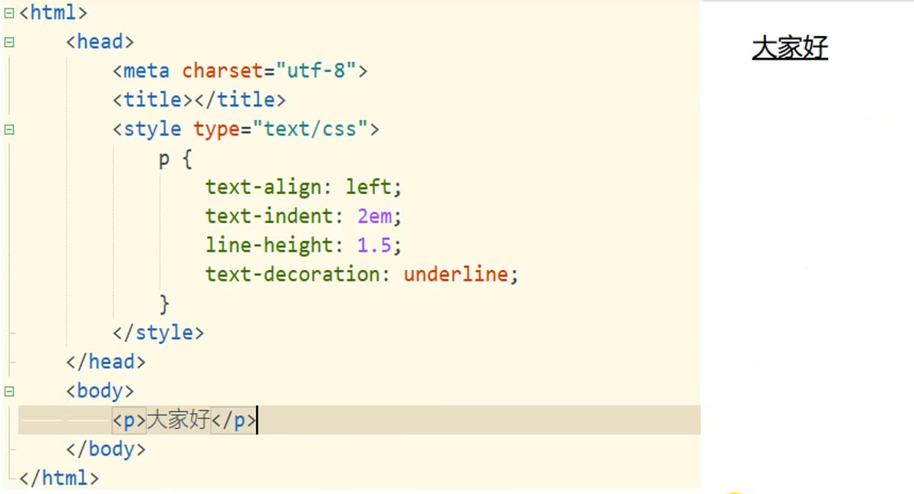

## 颜色属性

- **文本颜色**：通过 `color` 属性设置文本的颜色

  - 颜色名称（如 red、blue)
  - 十六进制颜色代码（如#ff0000、#0000ff）
  - RGB 值（如 rgb(255, 0, 0)、rgb(0, 0, 255)）
- **背景颜色**：通过 `background-color` 属性设置元素的背景颜色，用法与 `color` 属性类似。

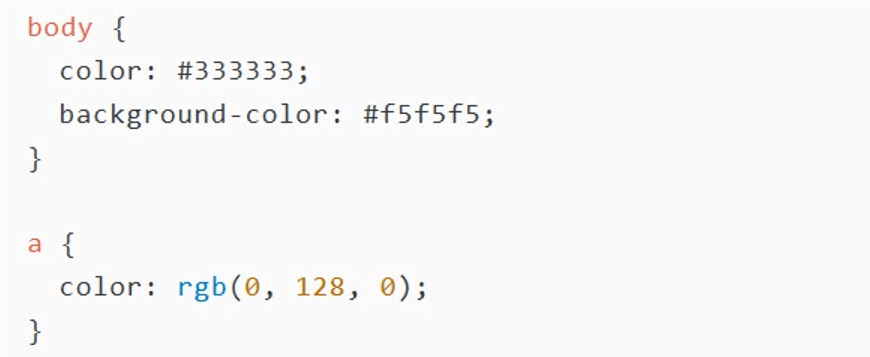

## 背景属性

- **背景图像**：通过 `background-image` 属性设置元素的背景图像

  - 使用 url() 函数指定图像路径。
- **背景重复**：通过 `background-repeat` 属性控制背景图像的重复方式

  - 取值为 repeat（平铺)、no-repeat（不重复）、repeat-x（水平平铺）、repeat-y（垂直平铺）等。
- **背景定位**：通过 `background-position` 属性设置背景图像的位置

  - 可使用关键词（如 top、bottom、left、right、center）或像素值、百分比等，
- **背景大小**：通过 `background-size` 属性设置背景图像的大小

  - 可取值为具体的尺寸（如 100px，50px）、百分比或 cover（覆盖整个无素区域）、contain（完整显示图像）等。

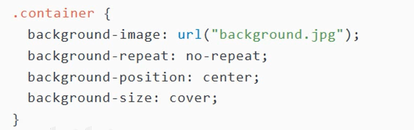

---

# 盒子模型*

## 盒子模型的基本概念

- **盒子模型的定义**

  - 在 CSS 中，每个 HTML 元素都可以看作是一个矩形的盒子
  - 盒子由内容区、内边距、边框和外边距四个部分组成。
- **盒子模型的类型**

  - 标准盒子模型（内容区 + 内边距 + 边框 + 外边距）
  - 怪异盒子模型(IE 盒子模型，内容区 + 内边距 + 边框=宽高)
  - 通过 `box-sizing` 属性可以切换盒子模型类型，取值为 content-box（标准盒子模型，默认值）和 border-box（怪异盒子模型）。

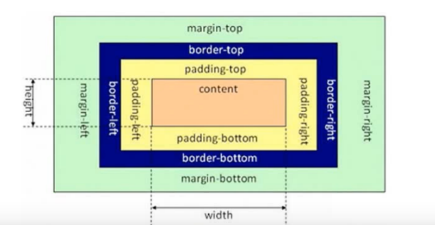

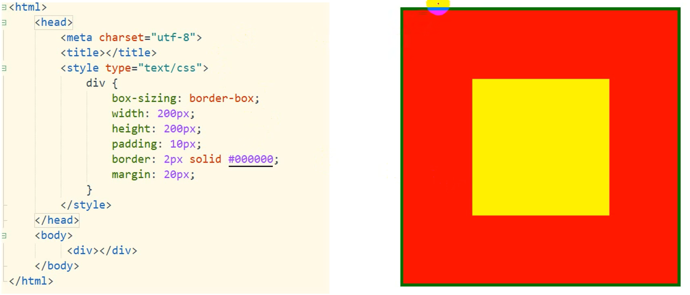

## 内容区

- **内容区的定义**：盒子模型的核心部分

  - 用于显示实际内容，由 width 和 height 属性定义宽度和高度。
- **内容区的尺寸计算**：

  - 在标准盒子模型中，内容区域的宽度和高度不包括内边距、边框和外边距：
  - 在怪异盒子模型中，内容区域的宽度和高度包括内边距和边框，但不包括外边距。

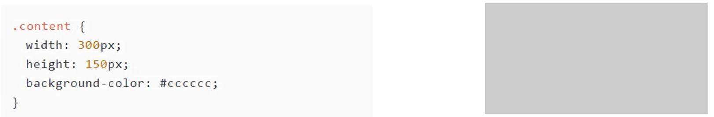

## 内边距

- **内边距的定义**：内容区域与边框之间的空间，用于增加内容与边框之间的距离，padding 属性定义。

  - 可设置一个值（上下左右相同）：padding 100px
  - 两个值（上下/左右）：padding 100px 200px
  - 三个值（上/左右/下）：padding 100px 200px 300px
  - 四个值（上/右/下/左）：padding 100px 200px 300px 400px
- **内边距的影响**：增加内边距会使盒子的总宽度和高度增加。

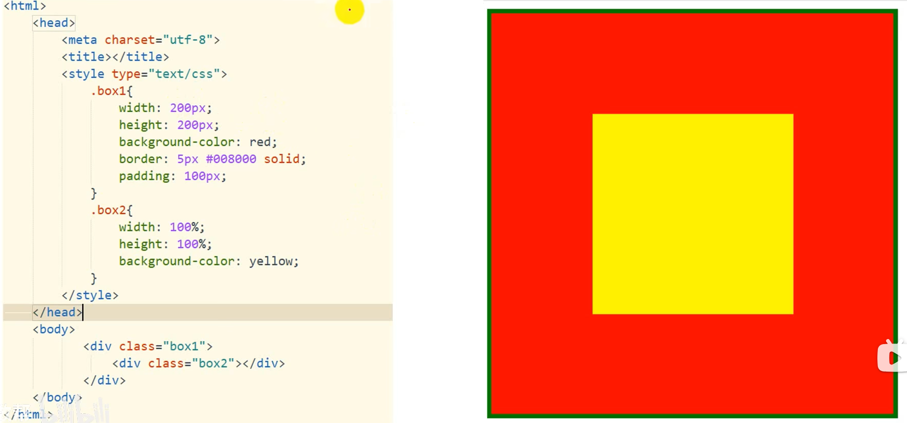

## 边框

- **边框的定义**：围绕内边距的线条，用于装饰和分隔内容，由 `border` 属性定义，

  - 包括 border-width（边框宽度）、border-style（边框样式）和 border-color(边框颜色）
- **边框的样式**：常见的边框样式有 none（无边框）、solid（实线）、dashed（虚线）、dotted（点线）、double（双线）等
- **边框的简写**：可以使用 `border` 属性同时设置边框的宽度、样式和颜色

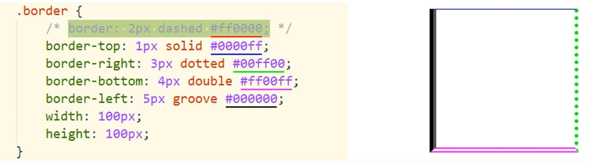

## 外边距

- **外边距**：指的是当前盒子与其他盒子之间的距离，

  - 外边距不会影响盒子的大小，而是会影响盒子的位置
  - 四个方向：margin-top、margin-right、margin-bottom、margin-left
- **margin 简写**：

  - margin（上下左右相同）: 100px
  - margin（上下/左右）: 100px 200px;
  - margin（上/左右/下）: 100px 200px 300px;
  - margin（上/右/下/左）: 100px 200px 300px 400px
- **margin**：可以设置为 auto，auto 一般只设置给水平向的 margin

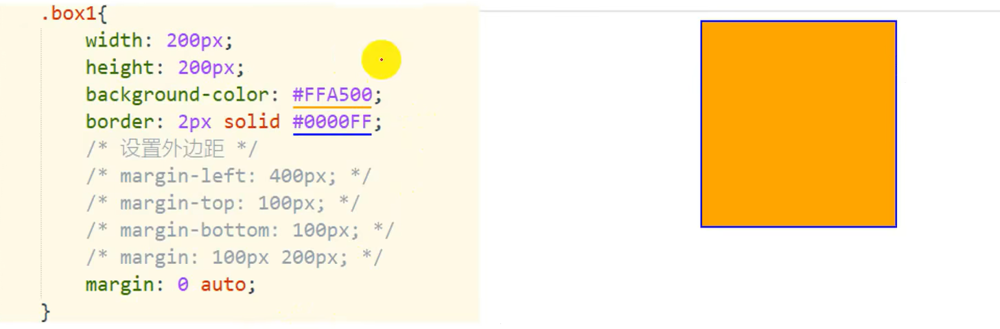

---

# 浮动

## 文档流

- **文档流**

  - 指在网页布局中，HTML 元素按照其默认的布局规则自然排列的方式。
  - 具体来说，文档流中的元素会根据其标签类型（如块级元素和内联元素)以及默认的 CSS 样式，按照从上到下、从左到右的顺序排列。
- **特点**

  - **块级元素**：如 `
`、`
`、`<h1>` 等，通常会独占一行，并且其宽度默认会占满父容器的宽度。
  - **内联元素**：如 ``、`<a>`、`` 等，不会独占一行，而是与其他内联元素在同一行排列，直到没有足够的空间时才会换行。（如果想设置其宽高之类的：`display : inline-block`)
    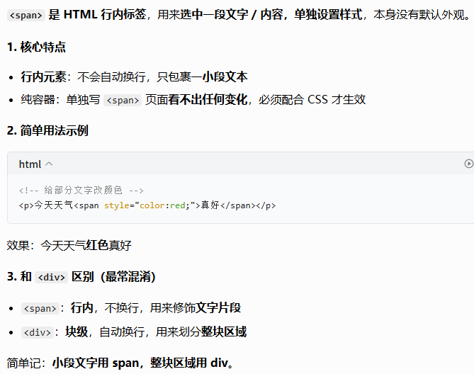
- **自然排列**：元素按照 HTML 代码的顺序依次排列，除非通过 CSS 进行特殊调整。
- 理解文档流是网页布局的基础，它决定了元素在页面上的默认排列方式

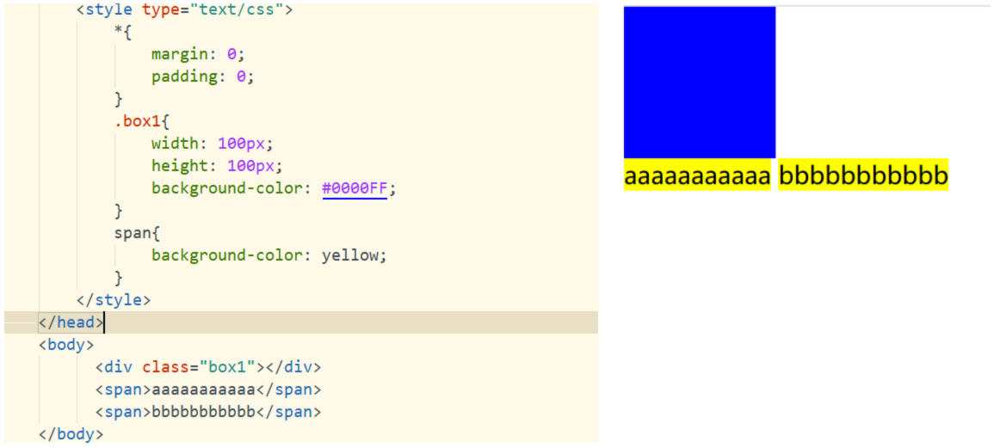

## 浮动的基本概念

- **浮动的定义**

  - 浮动是 CSS 中一种使元素脱离文档流，向左或向右移动，直到碰到包含框的边框或另一个浮动元素的布局方式。
- **浮动的特点**

  - 浮动元素会脱离正常的文档流，其他非浮动元素的布局会受到影响。
  - 浮动元素会按照设置的方向排列，直到遇到包含框的边框或其他浮动元素。
  - 浮动元素的父元素如果没有设置高度，会出现高度塌陷的问题。

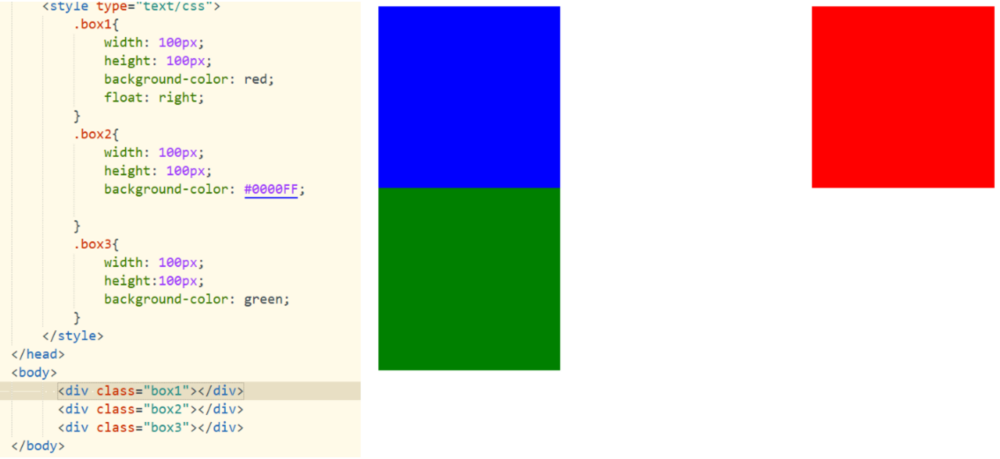

## 浮动的实现方法

- **使用**`float`**属性**

  - 通过 `float` 属性设置元素的浮动方向，
  - 可取值为 left（向左浮动）、right（向右浮动）、none（不浮动，默认值）。
- **浮动的语法格式**：`float：left;` 或 `float: right;`。
- **浮动的元素类型**：通常用于块级元素的浮动。

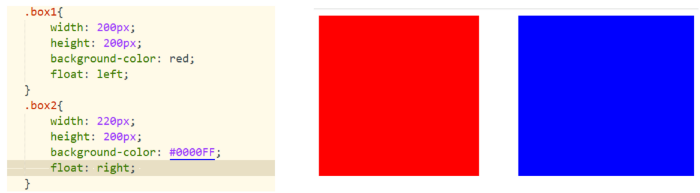

## 清除浮动

- **清除浮动的必要性**：由于浮动元素会脱离文档流，其他元素浮动可能对当前元素产生的影响的时候，影响布局，因此需要清除浮动。
- **清除浮动的方法**：通过 `clear` 属性设置元素清除浮动，

  - 可取值为
    - left（清除左侧浮动)
    - right（清除右侧浮动)
    - both（清除两侧浮动)
    - none（不清除浮动，默认值)
- 下方代码中，box1 浮动脱离正常文档流，box2 按照正常文档流无视了 box1，因此蓝色被红色覆盖（box2 的文字不受浮动影响，将显示在第二行中），一般都使用 `position: absolute;`，就能连带背景和文字一起浮动了。

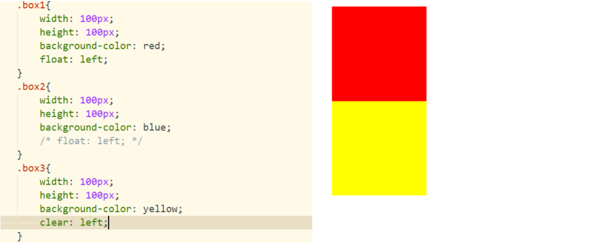

---

# 定位

## 定位的基本概念

- **定位的定义**：CSS 中的定位,用于控制元素在页面中的位置，通过 `position` 属性可以设置元素的定位方式。
- **定位的类型主要有：**静态定位（static）、相对定位（relative)、绝对定位（absolute）、固定定位（fixed）

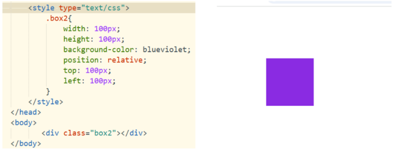

## 静态定位

- **静态定位的定义**：默认的定位方式，元素按照<u>正常的文档流</u>进行布局，`position` 属性的默认值为 static。
- **静态定位的特点**：静态定位的元素不受 top、right、bottom、left 等属性的影响，始终按照文档流的顺序排列。

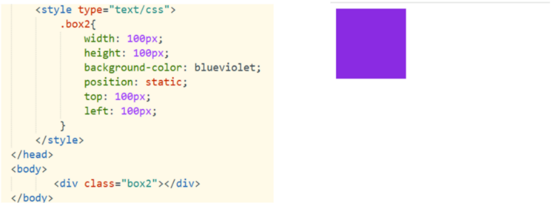

## 相对定位

- **相对定位的定义**：设置元素为相对定位，元素相对于其<u>正常位置</u>进行偏移。
- **相对定位的特点**：相对定位的元素仍然占据原来的空间，其他元素布局不受到影响，常用于<u>微调元素的位置</u>。
- **语法格式**：`position:relative;`，配合 top、right、bottom、left 属性使用。

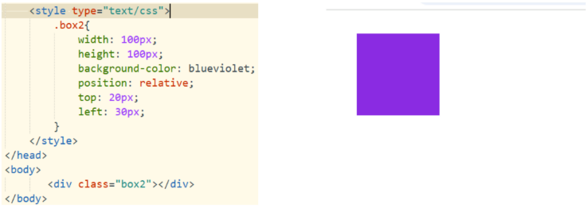

## 绝对定位

- **绝对定位的定义**：设置元素为绝对定位，元素相对于最近的定位<u>祖先元素</u>进行偏移，如果没有定位祖先元素，则相对于初始包含块（通常是浏览器窗口）。
- **绝对定位的特点**：绝对定位的元素会脱离文档流，不占据空间，其他元素的布局会受到影响，常用于<u>创建弹出框、下拉菜单等</u>。
- **语法格式**：`position: absolute;`，配合 top、right、bottom、left 属性使用。

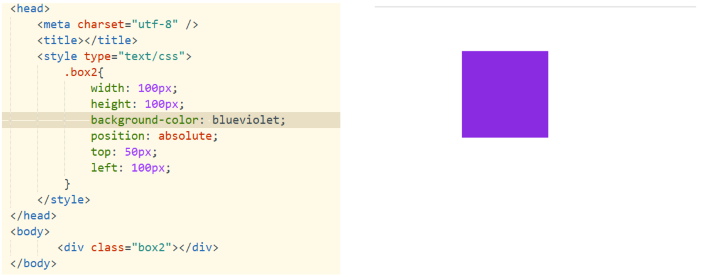

## 固定定位

- **固定定位的定义**：设置元素为固定定位，元素相对于<u>浏览器窗口</u>进行偏移，滚动页面时位置不变。
- **固定定位的特点**：固定定位的元素会脱离文档流，不占据空间，<u>常用于创建固定导航栏、回到顶部按钮等</u>。
- **语法格式**：`position:fixed;`，配合 top、right、bottom、left 属性使用。

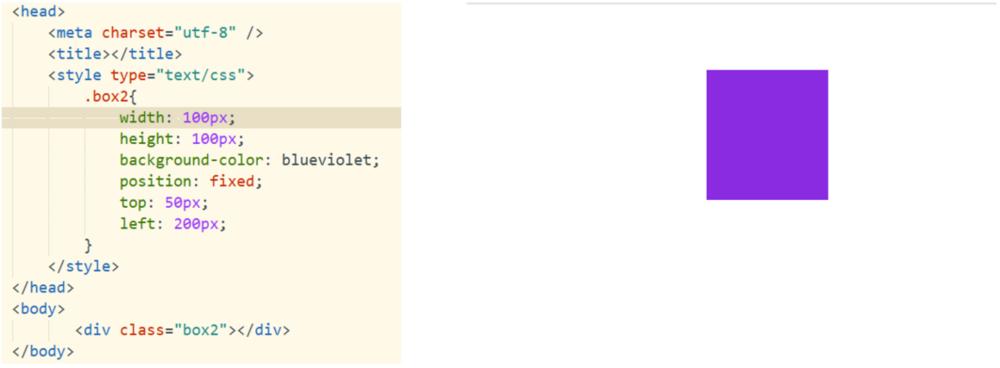

---

# [Flex 布局](https://www.bilibili.com/video/BV1cbCuBqE7L?spm_id_from=333.788.player.switch&vd_source=c08a6d0502d75eab102ad7cc0ce0eae8&trackid=web_related_0.router-related-2479604-6dnm7.1784102455766.1011)

## 定义

- 任何容器元素 +display：flex = flex 容器
- flex 容器的直接子元素 = flex 项目
- flex 容器中最重要的是主轴（main axis）和交叉轴（cross axis)

## 容器属性

作用于父容器

<table>
<tr>
<td>**属性** </td><td>**取值示例（含注释）** </td><td>**中文说明** </td></tr>
<tr>
<td>display </td><td>flex —— 启用弹性盒布局 </td><td>将元素设为Flex容器，子元素变为Flex项目 </td></tr>
<tr>
<td>flex-direction </td><td>row —— 水平从左到右（默认） row-reverse —— 水平从右到左 column —— 垂直从上到下 column-reverse —— 垂直从下到上 </td><td>定义主轴方向(即项目的排列方向)  </td></tr>
<tr>
<td>flex-wrap </td><td>nowrap ——  不换行（默认） wrap —— 换行，新行在下方 wrap-reverse —— 换行，新行在上方 </td><td>控制项目是否换行及换行堆叠方向  </td></tr>
<tr>
<td>justify-content </td><td>flex-start ——主轴起点对齐(默认) flex-end ——主轴终点对齐 center —— 主轴居中 space-around —— 每个项目两侧等间距 space-between —— 两端对齐，中间等间距 space-evenly —— 所有间隔（包括边缘）完全相等 </td><td>定义项目在主轴上的对齐与分布方式 </td></tr>
<tr>
<td>align-items </td><td>stretch——拉伸填满交叉轴（默认，高度/宽度未设时生效） flex-start ——交叉轴起点对齐 flex-end —— 交叉轴终点对齐 center ——交叉轴居中 baseline ——按文字基线对齐 </td><td>定义单行项目在交叉轴上的对齐方式 </td></tr>
<tr>
<td>align-content </td><td>stretch ——行拉伸填满剩余空间(默认) flex-start ——多行靠交叉轴起点 flex-end —— 多行靠交叉轴终点 center —— 多行整体居中 space-between——行之间两端对齐 space-around——行之间均匀环绕 </td><td>定义多行在交叉轴上的分布方式(仅当flex-wrap:wrap且有多行时生效) </td></tr>
</table>

## 项目属性

作用于子容器

<table>
<tr>
<td>**属性** </td><td>**取值示例（含注释）** </td><td>**中文说明** </td></tr>
<tr>
<td>flex-grow </td><td>0—— 不放大（默认） 1、2...——按比例放大（如两个项目都为1，则平分剩余空间） </td><td>空间有剩余时，项目的放大比例 </td></tr>
<tr>
<td>flex-shrink </td><td>1 ——可缩小（默认） 0 ——禁止缩小 2 —— 缩小比例更高 </td><td>空间不足时，项目的缩小比例 </td></tr>
<tr>
<td>flex-basis </td><td>auto ——根据内容或width/height 决定(默认) 100px——初始主轴尺寸为100px 20% —— 占主轴 20% </td><td>分配多余空间前，项目在主轴上的基准尺寸 </td></tr>
<tr>
<td>flex (简写) </td><td>0 1 auto——默认值(不放大、可缩小、基准为auto) 1 ——常用：等价于11 0%（现代浏览器），自动占满剩余空间 none —— 等价于0 0 auto(固定大小，不伸缩） </td><td>flex-grow flex-shrink flex-basis 的简写形式 </td></tr>
<tr>
<td>align-self </td><td>auto —— 继承容器的 align-items (默认) flex-start / center / stretch 等——覆盖容器设置 </td><td>单个项目在交叉轴上的对齐方式（可单独设置） </td></tr>
<tr>
<td>order </td><td>0 —— 默认顺序 -1 —— 排在前面 2 —— 排在后面 </td><td>控制项目显示顺序（数值越小越靠前，可为负数） </td></tr>
</table>

---

# [Grid 布局](https://www.bilibili.com/video/BV1yXqaBoEv1?spm_id_from=333.788.videopod.sections&vd_source=c08a6d0502d75eab102ad7cc0ce0eae8)

## 定义

- 任何容器元素 + display： grid = grid 容器
- grid 容器的直接子元素 = grid 项目

## 容器属性

<table>
<tr>
<td>**属性** </td><td>**取值示例（含注释）** </td><td>**中文说明** </td></tr>
<tr>
<td>display </td><td>grid —— 启用弹性盒布局 </td><td>将元素设为Grid容器，子元素变为Grid项目 </td></tr>
<tr>
<td>grid-template-columns </td><td>150px —— 包含一列150px 150px 150px —— 包含两列150px 1fr 2fr —— 分别占容器可用空间的1份和2份（可与上一种方法搭配使用） minmax(150px, 1fr) 1fr </td><td>显式设置每个布局包含多少列和尺寸  </td></tr>
<tr>
<td>grid-template-rows </td><td>repeat(3, 150px) —— 包含3个150像素行 </td><td>显式设置每个布局包含多少行和尺寸 </td></tr>
<tr>
<td>gap </td><td>1em 2em —— 表示上下1em，左右2em </td><td>用于在每个grid项目间添加间距 </td></tr>
<tr>
<td>grid-auto-rows </td><td>150px --- 设置新建的行轨道为150px高 </td><td>指定隐式行轨道的尺寸 </td></tr>
<tr>
<td>grid-auto-flow </td><td>row --- 默认值 column --- 变成隐式列轨道 </td><td>控制隐式轨道的行为 </td></tr>
<tr>
<td>justify-items </td><td>stretch --- 伸展占据网格单元格内所有可用空间（默认值） start --- 对齐到左边 end --- 对齐到右边 center --- 在水平方向居中 </td><td>控制项目在网格单元内水平方向的对齐 </td></tr>
<tr>
<td>align-items </td><td>stretch --- 伸展占据网格单元格内所有可用空间（默认值） start --- 对齐到上面 end --- 对齐到下面 center --- 在垂直方向居中 </td><td>控制项目在网格单元内垂直方向的对齐 </td></tr>
<tr>
<td>justify-content </td><td>start --- 对齐到左边（默认值） end --- 对齐到右边 center --- 在水平方向居中 space-between --- 两端对齐，中间等间距 space-around —— 每个项目两侧等间距（最左右边是1/2） space-evenly —— 所有间隔（包括边缘）完全相等 </td><td>控制所有项目在容器内的水平对齐方式 </td></tr>
<tr>
<td>align-content </td><td>同上 </td><td>控制所有项目在容器内的垂直对齐方式 </td></tr>
<tr>
<td>auto-fit </td><td>grid-template-columns: repeat(auto-fit, minmax(150px, 1fr)); </td><td>自动减少列数让项目换行  </td></tr>
<tr>
<td>auto-fill </td><td>grid-template-columns: repeat(auto-fill, minmax(150px, 1fr)); </td><td>自动减少列数让项目换行 </td></tr>
</table>

- ***-items** → 单个项目的对齐

  - 调整网格项目在其自身单元格内部的位置。
- ***-content** → 整体网格的对齐

  - 调整所有网格轨道作为一个整体在容器中的位置
  - 当容器有剩余空间时生效，即所有网格的尺寸小于容器的尺寸
- **auto-fit** → 折叠空轨道

  - 项目可能被拉伸，但容器内没有留白。
- **auto-fill** → 保留空轨道

  - 项目不被拉伸，容器内可能留白。

## 项目属性

<table>
<tr>
<td>**属性** </td><td>**取值示例（含注释）** </td><td>**中文说明** </td></tr>
<tr>
<td>grid-row-start / grid-row-end </td><td>grid-row-start: 1; grid-row-end: 3; 表示项目从第一条行线开始到第三条行线结束 </td><td>开始行线 / 结束行线 </td></tr>
<tr>
<td>grid-columns-start / grid-columns-end </td><td>grid-column-start: 1; grid-column-end: -2; 表示项目从第一条列线开始到倒数第二条条列线结束 </td><td>开始列线 / 结束列线  </td></tr>
<tr>
<td>grid-row / grid-columns </td><td>grid-row: 1 / 3; （开始行线1 / 结束行线3） grid-column: span 2; （从当前位置开始占据两列） </td><td>行线 / 列线 </td></tr>
<tr>
<td>z-index </td><td>z-index: 1; 具有更高 `z-index` 值的元素会覆盖具有较低 `z-index` 值的元素 </td><td>调整堆叠的顺序 </td></tr>
<tr>
<td>grid-template-areas </td><td>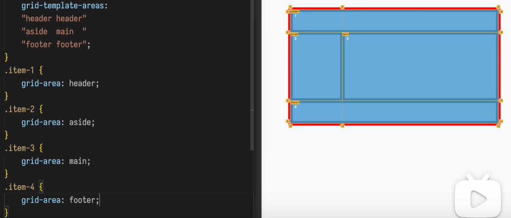 </td><td>可视化布局方法 一个引号代表一行 用`.`占位的话，表示该单元格为空 </td></tr>
<tr>
<td>justify-self </td><td>stretch --- 伸展占据网格单元格内所有可用空间（默认值） start --- 对齐到左边 end --- 对齐到右边 center --- 在水平方向居中 </td><td>单独控制项目在容器中的水平对齐 </td></tr>
<tr>
<td>align-self </td><td>stretch --- 伸展占据网格单元格内所有可用空间（默认值） start --- 对齐到上面 end --- 对齐到下面 center --- 在垂直方向居中 </td><td>单独控制项目在容器中的垂直对齐 </td></tr>
<tr>
<td> </td><td> </td><td> </td></tr>
</table>
