# Vue

# 基本了解

- Vue 是渐进式 Javascript 框架
- 作用：

  - 减少要编写的 DOM 操作，可以专注于逻辑操作
  - 将数据和界面的呈现相分离，降低代码耦合度
  - 支持组件化开发，利于中大型项目的代码组织
- Vue2 更好上手，Vue3 需要对框架有深刻的理解，同时有较强编程能力
- 使用 `<script src="../vue.js"></script>` 引入 vue

# Vue2 核心语法

## 响应式数据与插值表达式

- 响应式数据：在 Vue 内部对数据进行操作，会自动更新到界面中（无需大量 DOM 操作）

  - 使用方法：
    - el 属性：用于设置 Vue 的生效位置
    - data：用于声明响应式数据
    - methods：用于封装逻辑代码
      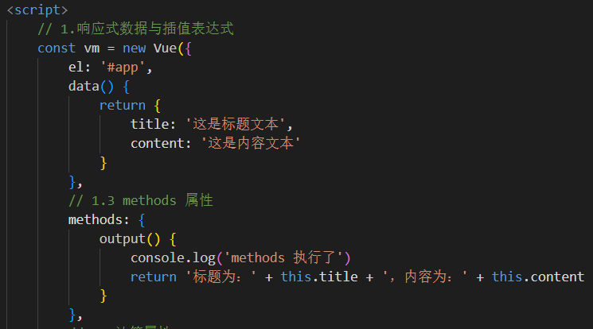
- 插值表达式：把响应式数据、运算结果渲染到页面 DOM 文本中

  - 只会解析文本内容，不能渲染 HTML 标签
    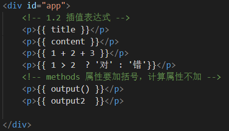

## 计算属性

- 计算属性：具有缓存性，会将计算结果在内部进行缓存，避免像放在 methods 里重复计算

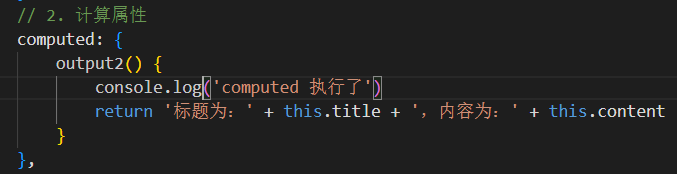

## 侦听器

- 侦听器：在每次页面变化时修改些别的东西，其中的数据必须是响应式的

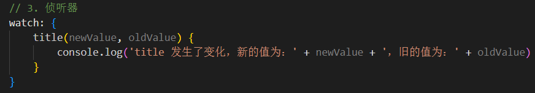

## 指令

- 内容指令

  - v-text, v-html 都能写入数据，其中后者可以解析 html 标签
  - 两个方式都会覆盖标签原始内容
- 渲染指令

  - v-for：遍历数据
  - v-if：通过布尔值控制元素是否进行创建和销毁，设置 false 元素会销毁（成本更高），不显示在控制台中
  - v-show：通过布尔值控制元素的显示与隐藏，设置 false 元素不会销毁，而是一个隐藏状态
    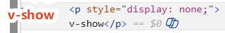
- 属性指令

  - v-bind：对属性的值进行绑定，v-bind 可以省略不写，也可以对类进行绑定
- 事件指令

  - v-on：可以直接将事件进行绑定，减少 dom 的书写。“v-on:”可以简写成“@”
- 表单指令

  - v-model：可以实现双向数据绑定（数据到界面，界面到数据）

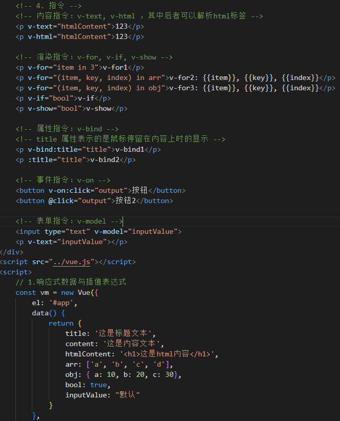

## 修饰符

- 修饰符：用来实现一些与指令相关的常用操作，用来简化代码和 DOM 操作。
- 有事件修饰符、按键修饰符、系统修饰符等，比如点了哪个键，不需要再进行多余 dom 书写
- 举例：

  - .trim：用来去除内容两端空格

## 示例代码

```html
<!DOCTYPE html>
<html lang="en">
<head>
    <meta charset="UTF-8">
    <meta name="viewport" content="width=device-width, initial-scale=1.0">
    <title>Document</title>
</head>

<body>
    <div id="app">
        <!-- 1.2 插值表达式 -->
        <p>{{ title }}</p>
        <p>{{ content }}</p>
        <p>{{ 1 + 2 + 3 }}</p>
        <p>{{ 1 > 2  ? '对' : '错'}}</p>
        <!-- methods 属性要加括号，计算属性不加 -->
        <p>{{ output() }}</p>  
        <p>{{ output2  }}</p> 
         
        <!-- 4. 指令 -->
        <!-- 4.1 内容指令：v-text, v-html ，其中后者可以解析html标签 -->
        <p v-text="htmlContent">123</p>  
        <p v-html="htmlContent">123</p>

        <!-- 4.2 渲染指令：v-for, v-if, v-show -->
        <p v-for="item in 3">v-for1</p>
        <p v-for="(item, key, index) in arr">v-for2: {{item}}, {{key}}, {{index}}</p>
        <p v-for="(item, key, index) in obj">v-for3: {{item}}, {{key}}, {{index}}</p>
        <p v-if="bool">v-if</p>
        <p v-show="bool">v-show</p>

        <!-- 4.3 属性指令：v-bind -->
        <!-- title 属性表示的是鼠标停留在内容上时的显示 -->
        <p v-bind:title="title">v-bind1</p>
        <p :title="title">v-bind2</p>

        <!-- 4.4 事件指令：v-on -->
        <button v-on:click="output">按钮</button>
        <button @click="output">按钮2</button>

        <!-- 4.5 表单指令：v-model -->
        <input type="text" v-model="inputValue">
        <p v-text="inputValue"></p>

        <!-- 5. 修饰符 -->
        <input type="text" v-model.trim="inputValue">
    </div>
    <script src="../vue.js"></script>  
    <script>
        // 1.响应式数据与插值表达式
        const vm = new Vue({
            el: '#app',
            data() {
                return {
                    title: '这是标题文本',
                    content: '这是内容文本',
                    htmlContent: '<h1>这是html内容</h1>',
                    arr: ['a', 'b', 'c', 'd'],
                    obj: { a: 10, b: 20, c: 30},
                    bool: true,
                    inputValue: "默认"
                }
            }, 
            // 1.3 methods 属性
            methods: {
                output() {
                    console.log('methods 执行了')
                    return '标题为：' + this.title + '，内容为：' + this.content 
                }
            },
            // 2. 计算属性
            computed: {
                output2() {
                    console.log('computed 执行了')
                    return '标题为：' + this.title + '，内容为：' + this.content 
                }
            },
            // 3. 侦听器
            watch: {
                title(newValue, oldValue) {
                    console.log('title 发生了变化，新的值为：' + newValue + '，旧的值为：' + oldValue)
                }
            }    
        })
    </script>
</body>
</html>
```

# 脚手架与组件开发

## 脚手架 Vue CLI

### 基本介绍

- Vue CLI 是官方根据 Webpack 打造的脚手架工具，内置了很多模板和工具，实现项目的快速创建
- 安装 Vue CLI

  - 首先安装 node.js
  - npm：安装 node.js 的同时会安装一个 npm（node package manager）的工具，是 node 包的管理器，可以通过 npm 安装一些包
  - `npm i @vue/cli -g`：i 表示 install，-g 表示在 node 全局进行安装
- vue/cli 目前已暂停维护，node 20+ 版本和 @vue/cli@5.0.9 存在兼容性问题，管道奔溃运行失败
- 推荐放弃 @vue/cli 来创建项目，改用官方新工具 `create‑vue`（推荐，不需要全局 cli，不受 node 版本限制）
  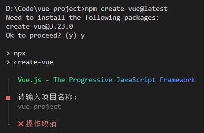

### 项目结构

- package.json 文件

  - scripts 里有一些命令：serve、build、link
    - serve：可以用来打开一个本地的静态资源服务器，把项目直接跑起来，方便在开发中使用。`npm run serve`
    - build：用于代码打包，打包后会存在于一个新建的目录“dist”中，最终项目上线时所使用的就是 dist 目录里的内容。`npm run build`
      - 可以 `npm i serve -g` 后通过 serve 方式运行该文件里的（打包后的）代码是 `serve dist`
- node-modules 目录：存放项目安装的所有包（第三方工具，无需改动）
- public 文件夹：保存一些不需要编译的资源

  - index.html、favicon.ico
- src 文件夹：保存一些需要参与编译的资源

  - assets 文件夹：包含 logo.png
  - components 文件夹：保存所有自定义组件的功能
  - App.vue（根组件）、main.js（入口文件，对 Vue 进行基础配置）
- babel.config.js：进行 babel 的配置
- vue.config.js：项目的配置文件
- 还有其他一些配置文件

### 组件

- 组件：封装页面部分功能的一种方式，提高代码复用率和可维护性
- .vue 为后缀的文件是一个单文件组件，包含三个部分：template、script、style（结构样式逻辑）
- 组件的使用：第四行写成单标签或者多标签的形式都可以
  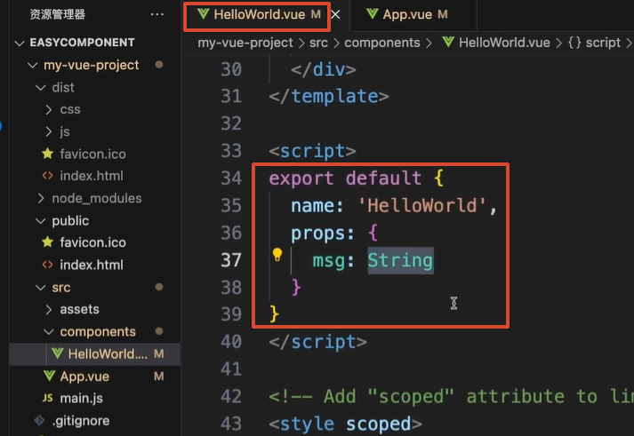
  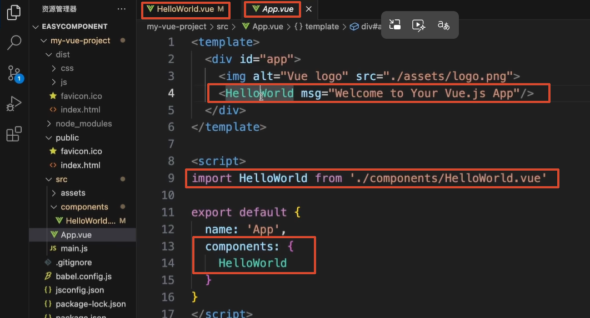
- 每个组件都是一个单独的 vue 实例，也可以使用 vue 的实例属性（el 除外，这个只能在根组件中进行设置，而内部的子组件作用位置实际上取决于写标签的位置）

## 组件通信

- 父组件向子组件传值：使用 props

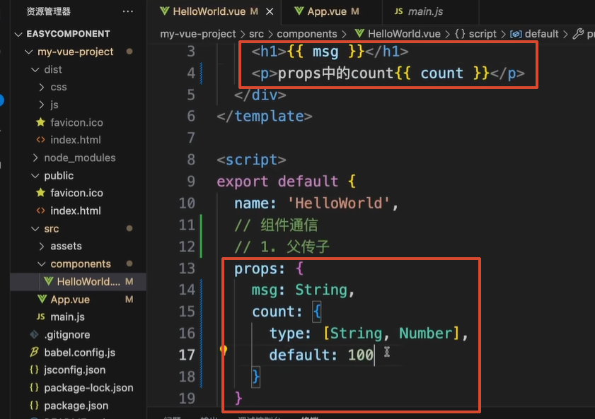

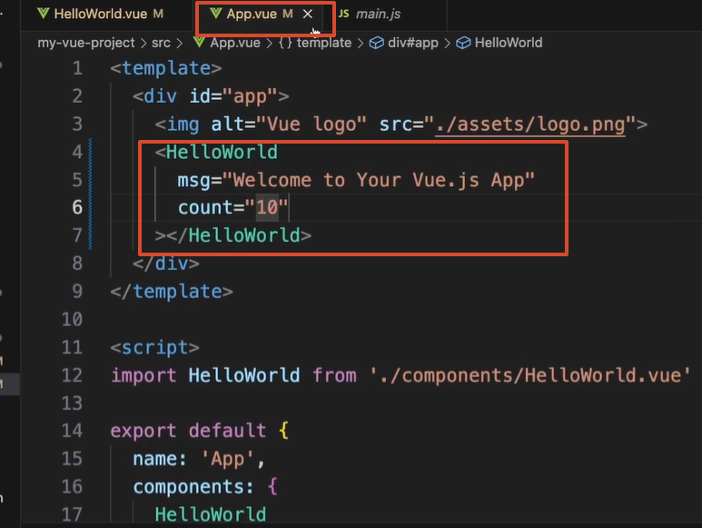

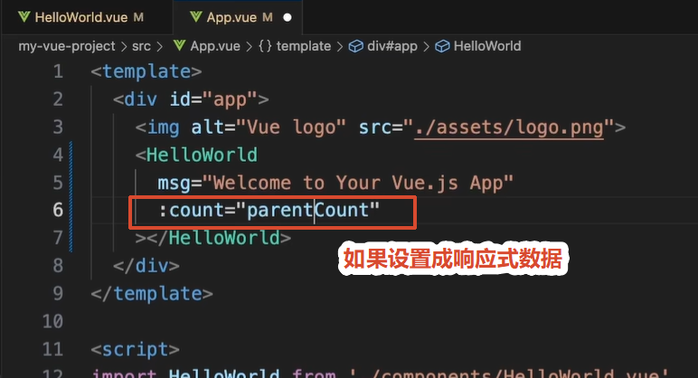

- 子组件向父组件传值：使用自定义事件
  - 在子组件使用 $emit() 用于触发自定义事件
    - $emit(触发的事件名，事件要传递的数据)
      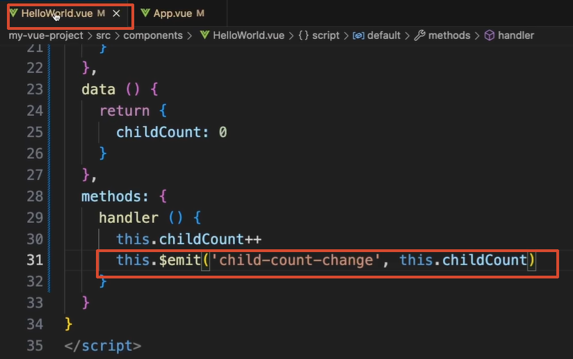
  - 在父组件进行监听
    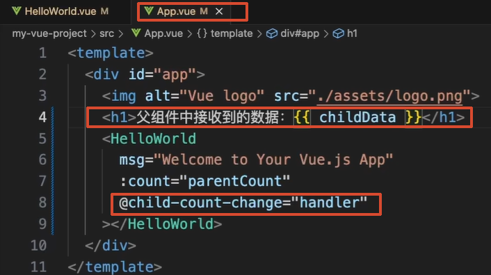
    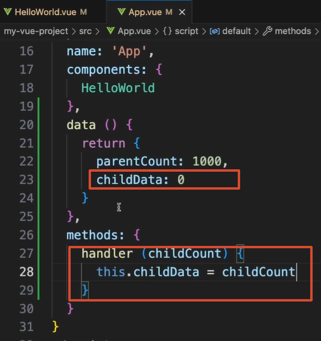
  - 同级组件值传递
    - 方式一：通过父来中转（先把子先传给父，再由父传给另外一个子）
    - 方式二：通过 EventBus 处理（通过额外的 Vue 实例进行存储）
  - 级别差很多的组件传递
    - 使用全局状态管理工具 Vuex

## 组件插槽

- 默认的插槽设置方式

  - 可以在父组件中写不同的插槽内容（可以是大段的 html），然后在子组件中进行显示
    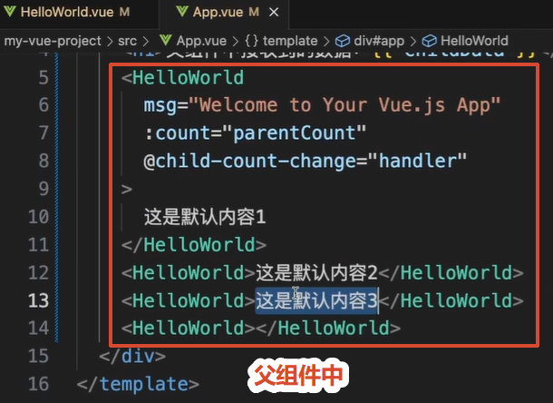
    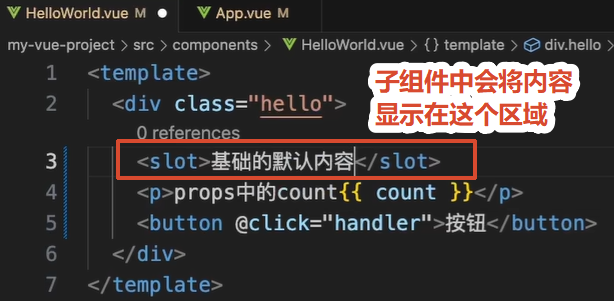
- 具名插槽：当组件里有好几个地方可以让外部通过插槽传值的话，可以通过“name”来做标记
  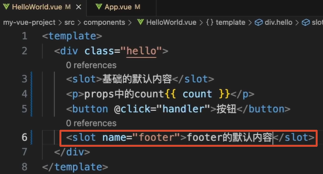
  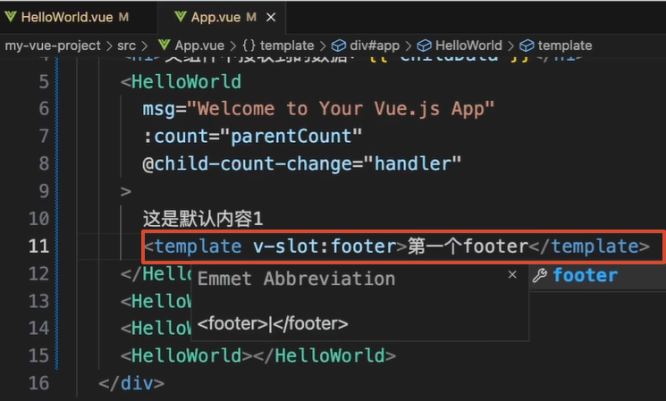

  - 简写成 `<template #footer>第—个footer</template>` 也行
- 作用域插槽：如果 footer 插槽要使用 HelloWorld 组件中的数据，需进行绑定

  - 子组件中
    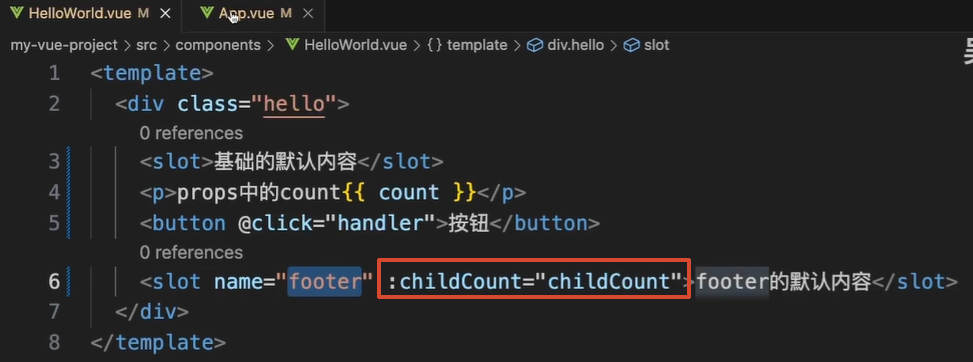
  - 父组件里两种写法
    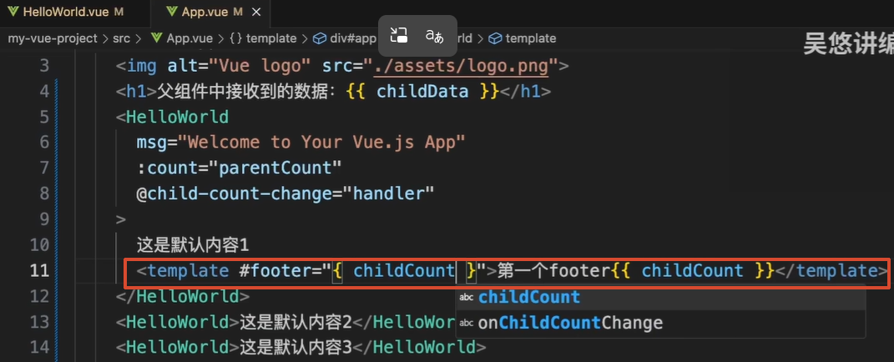
    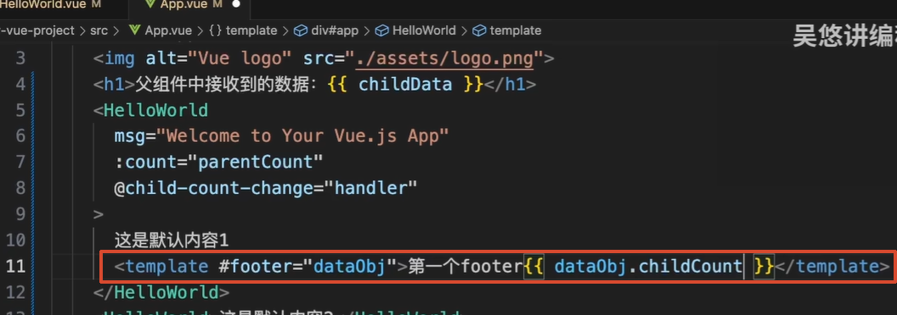

# VueRouter & Vuex

## VueRouter

- 用于构建单页面应用程序
  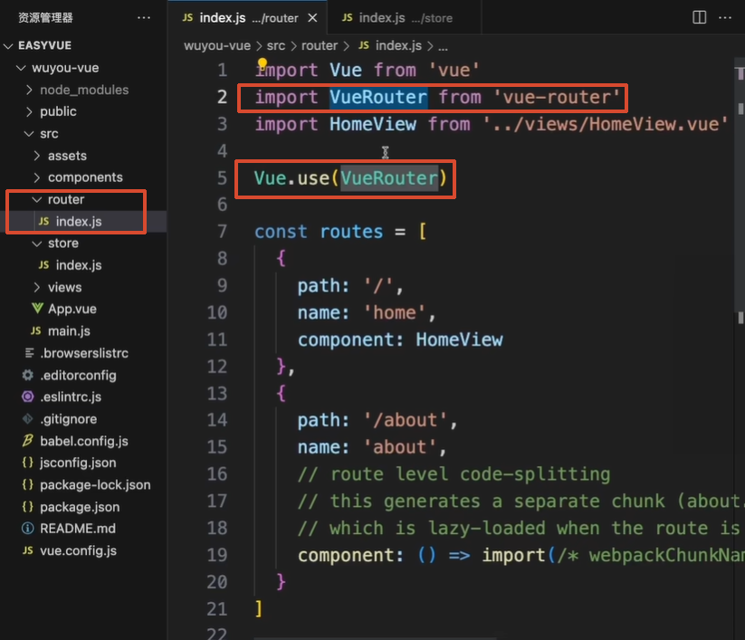
- Router 实例里一共有三个配置项
  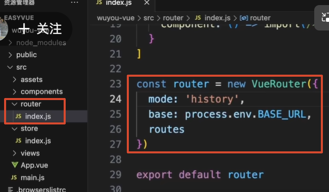

  - mode：hash 模式和 history 模式
    - hash 模式（默认）：网页路径上多一个“#”（如 localhost:8080/#/about），是单页应用，不是传统的多页应用，兼容性更好
    - history 模式：通过检测 url 后面地址变化进行使用，在低版本浏览器上运行需要进行其他处理
  - bash：基础的地址
  - routes：用来操作 Router 的重点位置
    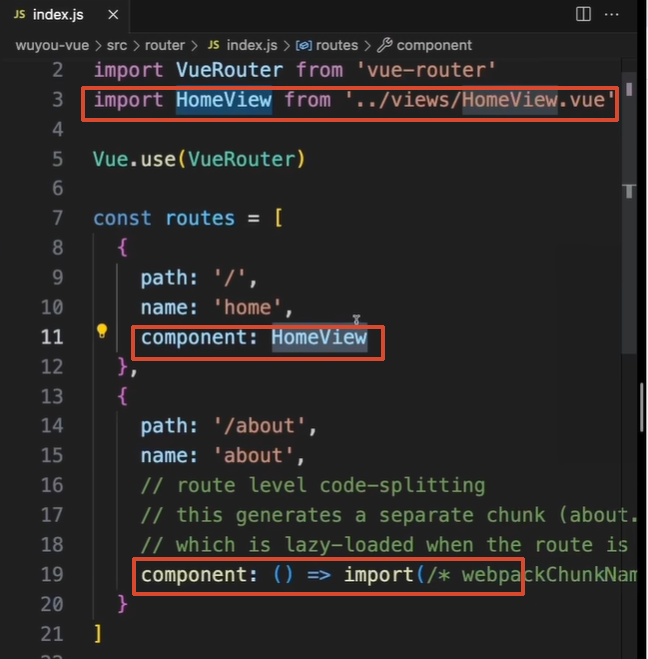
    - path：根目录
    - name：名称
    - component：跳转的组件名字（或者通过箭头函数的方式进行设置，如上面通过异步组件方式进行加载）
- 实现切换

  - router-view 表示组件显示的位置
    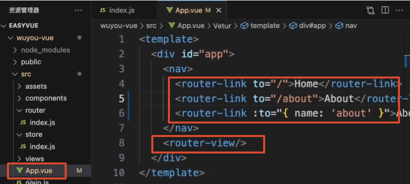
- 基本的路由使用

  - 在 views 文件夹中创建 .vue 文件，并在 export default 中配置 name
  - 在 router 文件夹的 index.js 文件中做一个引入（import xxx from xxx），并在 const routes 中进行配置
  - 在使用的文件中进行 router-link 配置

### 动态路由

- path 后面有冒号表示动态路由，props：true 表示可以在组件内部访问到动态路由的 ID 值
  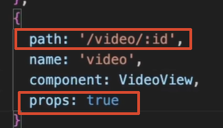
  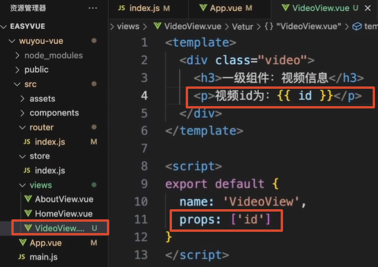
  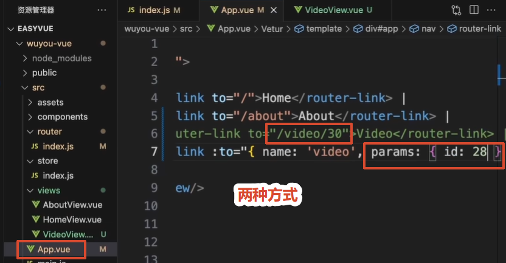

### 嵌套路由

- 路由里面又需要路由
  - App.vue 开头加上 `import VideoInfo1 from '../views/video/VideoInfo1.vue'`
  - 在 views 文件夹中新建 video 文件夹
    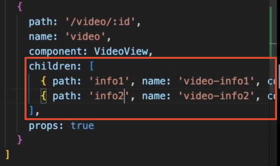
    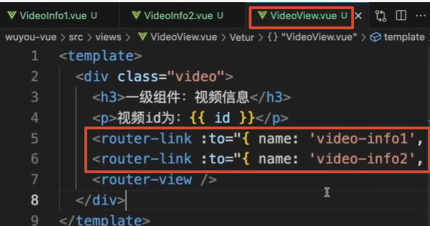

### 编程式导航

- 实现代码在运行过程中自己进行页面的跳转，而不让用户进行点击才跳转
- 实现方式

  - created：当组件创建完毕后会执行的生命周期钩子
  - 除了 push，router 里面还有一些别的方法（如 replace）
    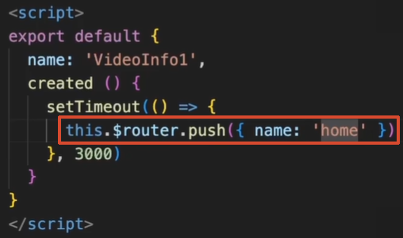

### 路由传参

- 跳转路由的时候进行数据的传递：可以通过 query 的方式进行设置
  - 数据传递：this.$router-push({ name: 'video-info2', query: { someData: 'info1 传递的数据' }})
  - 数据接收：
    - 动作使用 router，地址使用 route
      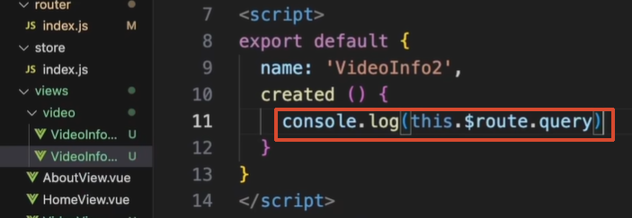

### 导航守卫

- 可以用来给所有导航做一个统一的设置：如在切换过程中加一个进度条
- 全局导航守卫：每次进行导航都会被触发（不调用 next 就不会进行后续的正常处理）
  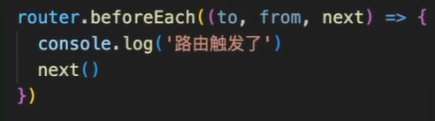

## Vuex

- 是一个统一的数据存储方式
- state：一个存数据的地方（建议写成函数的方式）
  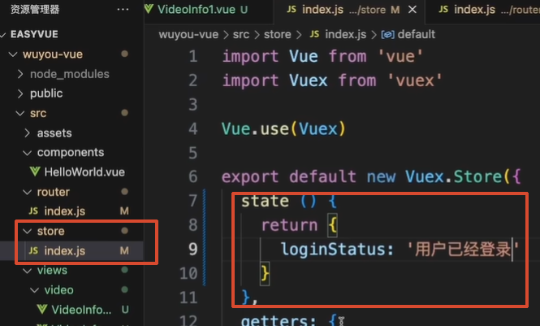
  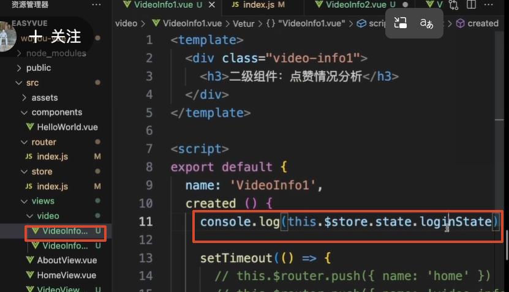
- mutations：在全局中去修改状态，通过 commit 的方式进行提交（必须是同步的）
  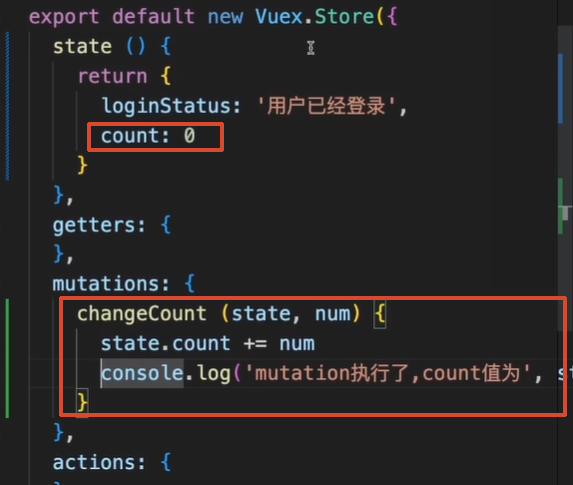

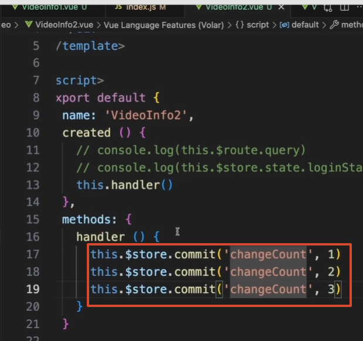

- actions：用来做异步包装，其中修改的部分也需要放到 mutation 中去完成
  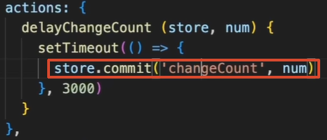
  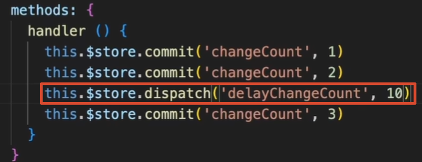
- getters：相当于计算属性，具有缓存性（内容没有变的情况下会缓存结果）
  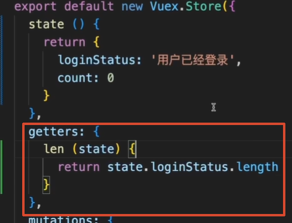
  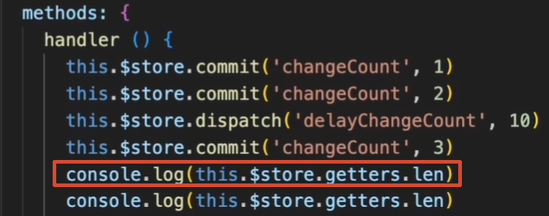
- modules：对不同功能用到的方法进行划分（相当于用的时候要多包一层）

  - 在 store 文件夹中新建一个 module 文件夹写入 a.js、b.js，然后通过下面的方式进行引入和使用
    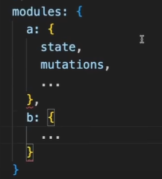
    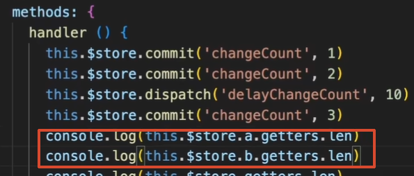

# Vue 综合案例

- TodoMVC

# Vue3 核心语法

- 选项式 vs 组合式

  - 选项式就是 Vue2 中的使用方法，较为分散
  - 组合式的代码更集中，使用更灵活，可以随意在代码任意位置进行响应数据声明、函数封装、计算属性设置等
    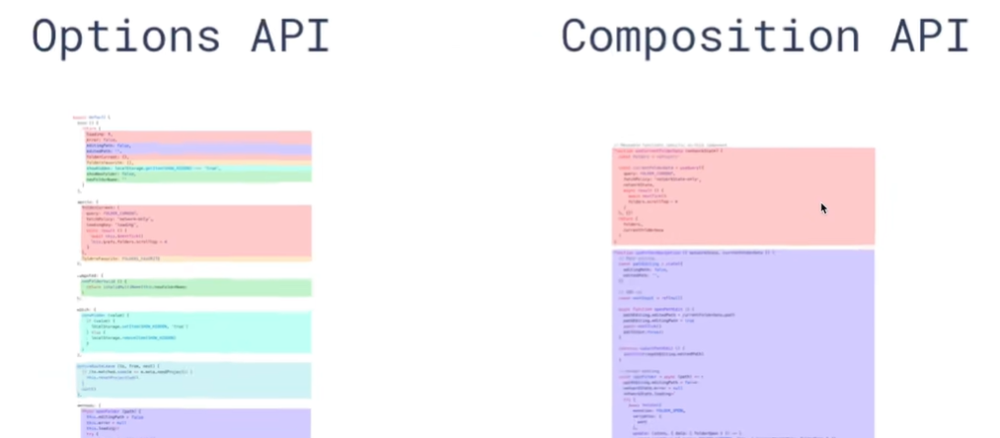
- 组合式使用方法

  - 将 `<script>` 写成 `<script setup>`，修改后所有 script 内部空间都相当于在 export default 里写一个 setup 函数，内部 import 的组件都会自动成为当前组件的子组件

## Reactive

- reactive：把对象 / 数组变成响应式数据
  - 原理：基于 proxy 实现

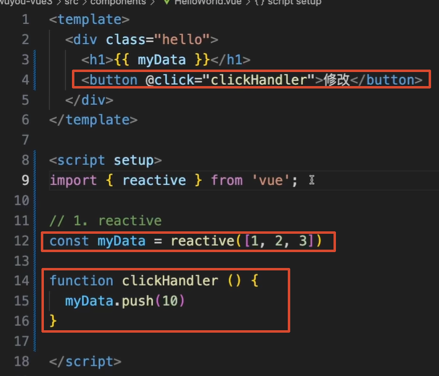

- shallowReactive：如果数据有很多维，只需要第一层是响应式的，就可以将数据设置为浅响应式

## Ref

- ref：适用于基本类型值（非对象值）
  - 原理：创建 ref 时会在内部生成一个新的对象，把要使用的值挂在对象的 value 属性上，再对这个对象进行响应式处理
    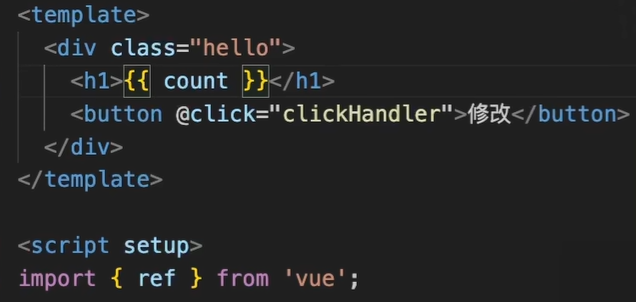
    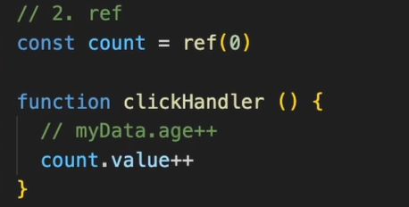

## Readonly

- readonly：用来声明只读数据的一种函数
  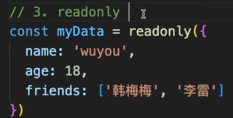
- shallowReadonly：如果在操作时仅仅希望根属性是只读的

## Computed

- computed：类似于计算属性
  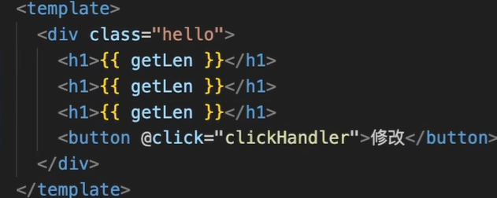
  

## Watch

- watch：侦听器
  - 侦听 ref：
    
  - 侦听 reactive：因为 reactive 只能监听对象本身，监听属性的话要采取下面函数的方式
    

## WatchEffect

- watchEffect：用于创建副作用函数，在进行操作修改时进行触发（无需指定侦听哪个值，如果内部包含的任意响应式数据发生变化，会自动执行该副作用函数）

# Pinia

- 相当于对 Vuex 的一个升级
- 核心区别：pinia 会自动将我们在模块中使用的组合式函数识别为状态管理的相关内容

  - 比如会将 ref 识别为 state 的声明，computed 相当于 getters，function 相当于 actions
  - 模块的设置与使用
    
    
